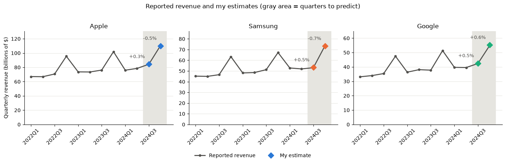

# Nowcasting Company Revenue from Credit Card Data

Estimating the quarterly revenue of Apple, Samsung and Google from 158,031 credit card transactions made by a panel of 2,500 consumers. This was a case study for the PolyFinances investment club (Polytechnique Montréal), as part of the team selection for the Rotman International Trading Competition (RITC).

> The data is **synthetic** and was provided by PolyFinances. It does not describe the real companies. It is **not included** in this repository.

## Result

Average error of **0.54%** on the held-out quarters (Q3–Q4 2024), versus 0.83% in the walk-forward backtest. All 6 actual values fall within the uncertainty interval (± 2 backtest standard errors).

| Estimated revenue (\$ billions) | 2024Q3 | 2024Q4 |
|---|---|---|
| **Apple** | 84.54 (82.93 to 86.21) | 110.06 (107.97 to 112.24) |
| **Samsung** | 53.34 (52.32 to 54.39) | 73.30 (71.91 to 74.75) |
| **Google** | 42.60 (41.79 to 43.45) | 55.29 (54.24 to 56.38) |



## Approach

1. **Inspection.** The data contains three traps:
   - amounts recorded in cents instead of dollars (about 5% of Apple's transactions);
   - a missing vendor (about 36% of Google's Pixel rows);
   - negative amounts.
2. **Cleaning, validated without the test quarters.** In 2022, reported revenue is exactly proportional to the cleaned panel sales. Removing any single cleaning decision breaks this proportionality.
3. **Model.** Revenue ≈ panel sales × a company-specific ratio. The final estimate averages two ways of estimating that ratio: the average over all past quarters, and the ratio of the same quarter last year.
4. **Evaluation.**
   - A walk-forward backtest (18 forecasts), then a single comparison with the held-out quarters.
   - A benchmark that does not use the card data is about 4 times less accurate.
5. **Sensitivity.** Each cleaning decision is undone, one at a time, to measure its impact. Not fixing the cents raises the error from 0.54% to 7.18%.

**Key lesson:** a stable bias (for example, the same share of missing vendors every quarter) is absorbed by calibrating the ratio. A noise that changes every quarter (the amounts in cents) is not; only cleaning removes it.

## Repository

| File | Content |
|---|---|
| `revenue_nowcast_en.ipynb` | Full analysis in English, with outputs |
| `revenue_nowcast_fr.ipynb` | French version (the original submission) |
| `requirements.txt` | Python dependencies |
| `images/estimates_vs_actual.png` | Result chart |

## Running the notebook

The notebooks already contain their outputs, so they can be read on GitHub without running anything.

To run them, place the three data files from the case study in a `data/` folder:

```
data/credit_card_transactions.csv
data/masked_reported_financials.csv
data/reported_financials.csv      # optional: without it, the evaluation section is skipped
```

Then:

```bash
pip install -r requirements.txt
jupyter notebook revenue_nowcast_en.ipynb
```

Tested with Python 3.12, pandas 2.1 and 3.1.
